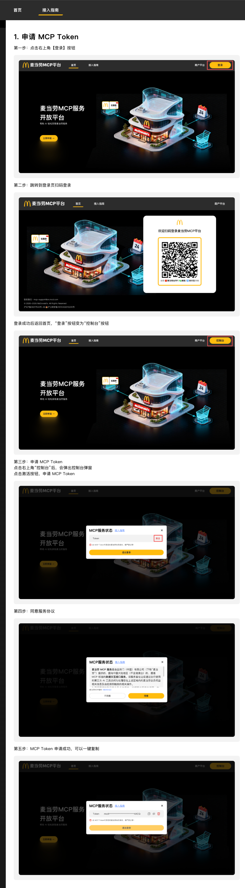

# 麦门封神榜

> 你在麦门算老几？领取你的麦门专属身份

麦当劳程序员创意开发大赛独立参赛作品，非麦当劳官方产品。基于 [麦当劳中国 MCP](https://github.com/M-China/mcd-mcp-server)，年报与名片用代码生成，并附带18张已生成的男女等级角色图；日常使用无需调用模型生图。

## 三件套，一份身份

| 功能 | 产物 | 视觉 |
| --- | --- | --- |
| 麦门年报 | 动画 HTML + 1080px 宽 PNG 长图 | 消费回顾、口味排行、月份节拍、最终门派身份与角色 |
| 麦门名片 | HTML + PNG | 门派、称号、境界、个人纹章、数据依据 |
| 专属头像 | HTML + SVG + PNG | 同一个身份对应的原创代码角色，按境界变化冠饰、光环与星纹 |
| AI 头像扩展 | 可选生图简报 | 仅明确选择后使用 Agent 的生图能力；不影响核心功能 |

项目只做身份视觉创作，不提供餐饮决策或交易功能。默认汉堡插画、角色、纹章为代码绘制，不表示官方餐品图片或会员等级。人物衣服保留小巧的金黄色麦当劳双拱门 M 胸标；后续模型头像沿用简约粗黑线红黄涂鸦风，不做 OK 手势。

## 预置人物图：男女各9个等级

半身版、红黄配色、粗黑线涂鸦风；每个等级男女各一张，不区分门派，衣服保留小号金色麦当劳 M 胸标。低阶朴素，高阶逐步增加发饰、飘带和光轮。

| 男性扫地僧 | 女性扫地侠 |
| --- | --- |
|  |  |

全部素材：[男性9级图鉴](assets/characters/male-v1/README.md) · [女性9级图鉴](assets/characters/female-v1/README.md)。每套含独立 PNG、按等级索引的 `manifest.json` 和完整生成提示词。

制作名片时可通过 `--portrait-image` 选择对应等级的人物图；默认纯代码头像仍可用。预置素材已经生成并随项目提供，使用这些图片无需实时生图。原始参考截图、失败草稿、私人名片、预览和 ZIP 打包产物不纳入仓库。

## 如何确定身份

统一实现：[identity.py](src/mcd_life_kit/identity.py)，可调整的预设：[identity_rules.json](src/mcd_life_kit/identity_rules.json)。年报、名片、头像绝不分别猜测称号；`all` 一次查询，共享同一个快照和规则版本。

**阅历 = 完成订单数 × 2 + min(有记录月份,12) + min(餐品种类,12)**。同一天多笔完成订单分别计入，订单贡献不封顶；月份与餐品种类各最多加12分。只使用已完成、去重后的已知数据；金额、性别不参与等级。该分数是虚构世界观的生成规则，不是现实评价，也不提供升级消费建议。

| 最低阅历 | 境界 | 预设身份（男 / 女） |
| --- | --- | --- |
| 0 | 初识 | 麦门新客 |
| 4 | 入门 | 见习小师弟 / 见习小师妹 |
| 12 | 修习 | 藏味扫地僧 / 藏味扫地侠 |
| 50 | 入室 | 关门大弟子 |
| 70 | 宗师 | 一派掌门 |
| 90 | 出尘 | 云游散仙 |
| 110 | 登仙 | 金拱真仙 |
| 135 | 仙境 | 赤金仙君 / 赤金仙姬 |
| 160 | 神境 | 麦门真神 |

扫地僧覆盖12—49分；已移除“入室弟子”。例如9笔订单、6个有记录月份、15种餐品得 `9×2+6+12=36` 分，属于扫地僧。活跃天数仍作为年报展示统计，但不再参与身份评分。达到160分即为最高等级“麦门真神”，男女同名；阅历仍按实际订单累计。

餐品关键词确定门派：薯山剑派、金堡门、麦咖书院、气泡宗、甜心谷、脆羽山庄；未知明细归逍遥门。一个餐品只分配一次，份数同分按预设顺序，口味不作为性别或现实性格的推断。

**官方接口只提供近期订单，不保证全年完整。** 年份只是本地筛选条件；身份和报告明确写“本次可见订单”。金额或餐品明细缺失时不编造数据，真实模式失败也不回退成示例。

## 在 Agent 中使用 Skill

项目入口见 [SKILL.md](SKILL.md)。

1. 首次使用且未配置 Token 时，Agent 先展示官网入口二维码、可点击链接和申请教程图，让用户完成登录并复制 Token；可直接发到对话框，或写入 `.env`。
2. 完成连接后，用户没有明确目标时，Agent 展示：年报 / 名片 / 头像 / 全套，并等待选择。
3. 选定后，再询问可选性别称谓：男（默认）/ 女。跳过时使用男性称谓；已明确提供就不重复询问。
4. 若能从本人账号的明确字段获取性别，直接复用。目前真实 MCP 账户查询不含性别，不能把地址联系人性别当成账号性别。
5. 读取真实订单，统一定身份，再生成所选内容。开发讨论不触发创作问答。

性别仅用于称谓与角色预设，不影响分数、等级、门派，不推断真实长相。

## 安装和直接运行

Python 3.9+；PNG 导出额外需要 Node.js 20+：

```bash
npm ci
# 已安装 Google Chrome / Chromium 可跳过；也可用 CHROME_PATH 指定路径
npx playwright install chromium
```

在 [MCP 开放平台](https://open.mcd.cn/mcp) 申请 Token，可发到 Agent 对话框供本次使用，也可以写入已被 Git 忽略的 `.env`：

```dotenv
MCD_MCP_TOKEN=YOUR_MCP_TOKEN
```

```bash
# 未配置 Token 时展示登录教程；已配置则展示菜单，不查询个人数据
PYTHONPATH=src python3 -m mcd_life_kit.cli

# 三件套只查一次数据，共享同一身份
PYTHONPATH=src python3 -m mcd_life_kit.cli all --gender male --nickname 麦门同学

# 单独生成，省略 --gender 表示采用男性称谓，不是已读取到账号性别
PYTHONPATH=src python3 -m mcd_life_kit.cli annual-report --gender female
PYTHONPATH=src python3 -m mcd_life_kit.cli identity-card --gender male
PYTHONPATH=src python3 -m mcd_life_kit.cli identity-card --portrait-image /path/to/character.png
PYTHONPATH=src python3 -m mcd_life_kit.cli avatar --gender male

# 免 Token 的合成数据演示
npm run visual:demo

# 仅 HTML/SVG，不依赖 Node.js 导出环境
PYTHONPATH=src python3 -m mcd_life_kit.cli all --html-only --mock --year 2026

# 可选：生成头像生图简报；此命令本身不调用模型
PYTHONPATH=src python3 -m mcd_life_kit.cli avatar --ai-avatar-brief
```

支持 `--year`（默认当前年）、`--output`（自定义目录）、`--mock-data`（自定义演示 JSON）。CLI 不访问远程生图服务，也不嵌入任何模型密钥。

## 首次登录与 Token

先提供 **[官方平台与接入文档](https://open.mcd.cn/mcp)**、入口二维码及下方教程。打开官网，按当前页面提示完成登录，进入控制台激活、同意协议后复制 MCP Token。


复制后任选一种方式：

- **发到当前 Agent 对话框**：Agent 不回显完整 Token，默认仅用于本次操作，不自动保存。
- **写入配置文件**：项目根目录 `.env` 添加 `MCD_MCP_TOKEN=你的Token`，以后可直接复用。`.env` 被 Git 忽略。

可直接打开的教程页由标准库生成，内嵌全部图片，无需 Node.js：

```bash
PYTHONPATH=src python3 -m mcd_life_kit.cli setup
# 生成 out/setup/index.html

# 对话 Token / 终端单次使用：隐藏输入，不写入文件
PYTHONPATH=src python3 -m mcd_life_kit.cli annual-report --token-stdin
```

教程页也提供本地生成 `mcd-token.env` 下载的选项；输入内容不发往网络，下载后原样放到项目根目录即可自动读取，无需改名；该文件也被 Git 忽略。环境变量优先，其次 `.env`，再其次 `mcd-token.env`。入口二维码打开官网，不包含任何 Token，也不是自动授权回调。截图中的登录二维码是示意，实时登录步骤以官网为准。

<details>
<summary>展开 Token 申请图文教程（用户提供的参考截图）</summary>



</details>

## 打开作品

全套默认输出在 `out/maimen/`：`annual-report.html/.png`、`identity-card.html/.png`、`avatar.html/.png/.svg`、`identity.json`、`report-data.json`。单独生成则位于 `out/<功能名>/`。

HTML 双击后用 Chrome、Edge 或 Safari 打开，全部样式、插画和脚本内嵌，无服务器、CDN 或远程字体依赖。年报支持滚动揭幕、分层视差、数字与图表动画、自动播放、暂停和重看；名片有漂浮与金色流光。系统启用“减少动态效果”时关闭动画。**PNG 和 SVG 是静态图片；动画在 HTML 中播放。** 同目录保留 PNG，HTML 的保存按钮即可下载。

动画参考：[GSAP 动画实践](https://gsap.com/resources/mistakes/)、[Intersection Observer](https://developer.mozilla.org/en-US/docs/Web/API/Intersection_Observer_API)、[Web Animations API](https://developer.mozilla.org/en-US/docs/Web/API/Web_Animations_API)。实现使用浏览器原生能力，不依赖 GSAP。

`.env`、`mcd-token.env` 与 `out/` 默认不进入 Git。可公开仓库的是代码与合成示例；个人作品留在本地。产物不包含 Token、电话、地址、订单编号或门店信息；分享前自行确认昵称与汇总信息。

## 验证

```bash
npm test
npm run visual:demo
npm run test:report
npm run test:visual
```

覆盖规则边界、性别称谓、订单状态、去重、套餐拆分、金额精度、HTML 注入防护，以及离线打开、响应式布局、身份一致性、PNG 导出与播放操作。

MIT · 参赛声明见 [CONTEST_DECLARATION.md](CONTEST_DECLARATION.md)，实际接入与业务价值见 [MCP_INTEGRATION.md](MCP_INTEGRATION.md)。
